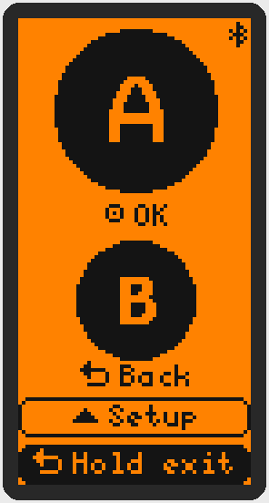
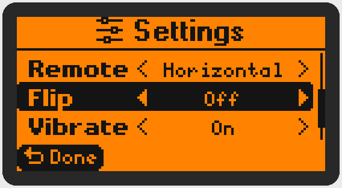

# AB Shutter Remote for Flipper Zero

**Turn pages on your e-reader with your Flipper Zero. And take selfies.**

Your Flipper becomes a Bluetooth remote like the popular **AB Shutter3** – and pairs **without a PIN**, so it works where the normal Flipper remote fails.

<p align="center">
  <a href="../../releases/latest"></a>
</p>

<!-- GIF here later: press a Flipper button → the e-reader turns the page -->

<p>
  
  
</p>

**Works with** anything that accepts an AB Shutter3:

- **E-readers** with Bluetooth page-turner support
- **Phones** – button A sends *Volume Up*, which takes a photo on iPhone and Android
- **Cameras, tablets** and other devices

## Install

1. Download the `.fap` for your firmware from **[Releases](../../releases)**.
2. Copy it to your Flipper's SD card into `apps/Bluetooth/` (qFlipper or the Flipper mobile app).
3. Start **AB Shutter Remote** under **Apps → Bluetooth**.

## Use it


1. Press **OK** to start pairing.
2. On your device, search for Bluetooth remotes and pick **AB Flipper**.
3. Connected – the remote screen appears. Next time it reconnects by itself.

| Remote button | Sends | Default Flipper button |
|---|---|---|
| **A** | Volume Up (shutter / next page) | OK |
| **B** | Enter | Back |

- Circles are **filled** when connected, **grid-shaded** while searching.
- Every press is confirmed by a short flash, the blue LED and a short vibration.
- **Hold Back to exit** – the exit tab fills up first, so a long page-turn press never closes the app.
- **Setup** is always on a free arrow key, shown bottom right.

<p>
  
  
</p>

## Settings

<p>
  
  
</p>

| Setting | Values |
|---|---|
| **A / B** | Which Flipper button triggers it: OK, Back, Up, Down, Left, Right – each also as *Hold*, except Hold Back |
| **Exit** | How long to hold Back to exit: 2s – 5s |
| **Remote** | Horizontal or vertical layout |
| **Flip** | Turns the screens by 180° for holding the Flipper the other way round |
| **Vibrate** | On / Off |
| **Forget pairing** | Removes the stored pairing (with confirmation) |

If you put an arrow key on A or B, Setup moves to the next free one. The arrows turn with the screen: *Left* is always the key pointing left in your hand.

## Why?

My e-reader found the Flipper, but pairing never finished: the standard Flipper Bluetooth remote asks for a **PIN confirmation**, and an e-reader can't give one. This app pairs like a real AB Shutter3 – **without a PIN ("Just Works")**.

## Build it yourself

With [uFBT](https://github.com/flipperdevices/flipperzero-ufbt):

```sh
ufbt update --index-url=https://up.momentum-fw.dev/firmware/directory.json   # Momentum SDK
ufbt          # build
ufbt launch   # build, install and start on a connected Flipper
```

Every pushed tag (e.g. `v1.0`) builds the app with GitHub Actions and attaches the `.fap` files to a new release. Developed for **Momentum**; uses the standard Bluetooth API, and the Action also builds for the official firmware.

## Credits

Idea, functions, design and UI/UX by **Don_Key_Moustache**, code written with the help of Claude (Anthropic).
Licensed under the MIT License.
