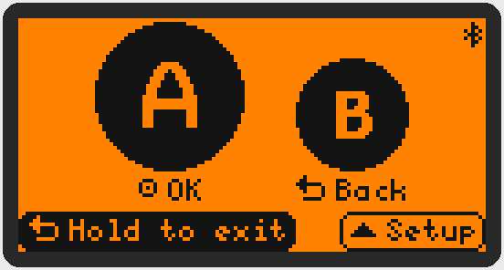
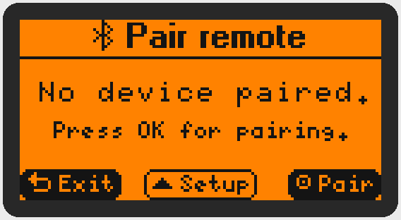
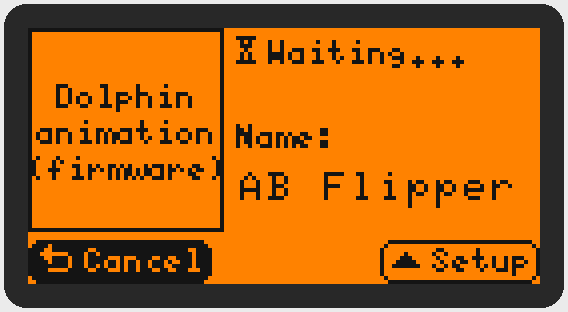
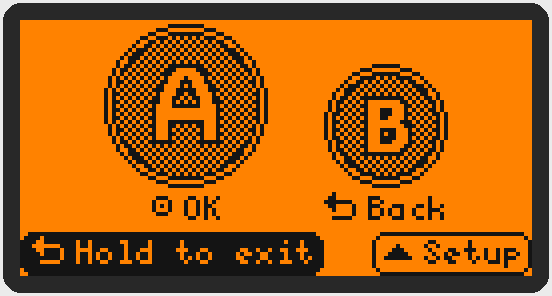
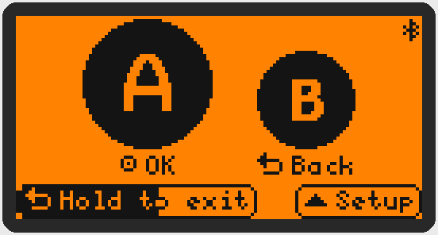
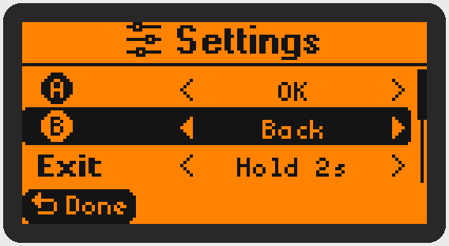

# AB Shutter Remote for Flipper Zero

Turns your Flipper Zero into a Bluetooth remote that behaves like the popular
**AB Shutter3** – the small two-button remote that often comes with selfie sticks and tripods.

Anything that works with an AB Shutter3 should work with this app:

- **E-readers** with Bluetooth page-turner support – turn pages from your Flipper
- **Phones** – take photos and selfies (button A sends *Volume Up*, which triggers the camera on iPhone and Android)
- **Cameras, tablets and other devices** that accept AB Shutter3 style remotes

<p>
  
  
</p>

## Why?

I wanted to use my Flipper Zero as a page turner for my e-reader. The e-reader found the
Flipper, but the connection never completed: the standard Flipper Bluetooth remote always asks
for a **PIN confirmation** while pairing, and an e-reader has no way to do that.

So I built this small AB Shutter3 style app – with the help of **Claude** (Anthropic's AI
assistant), which wrote most of the code together with me. It pairs the same way a real
AB Shutter3 does: **without a PIN ("Just Works")**. Now I can turn pages with my Flipper –
and take selfies with it, too.

## How it works

### First start: pair your device

<p>
  
  
</p>

1. Start **AB Shutter Remote** (*Apps → Bluetooth*). Press **OK** to start pairing.
2. On your device, search for Bluetooth remotes and select **AB Flipper**.
3. As soon as it is connected, the remote screen appears.

The pairing is remembered. Next time the app opens directly on the remote screen and your
device reconnects by itself.

### Remote

<p>
  
  
</p>

| Remote button | Sends | Default Flipper button |
|---|---|---|
| **A** | Volume Up (camera shutter / next page) | OK |
| **B** | Enter | Back |

- The circles are **filled** when connected and **grid-shaded** while searching for the device.
- A short flash, the blue LED and a short vibration confirm every button press.
- **Hold Back to exit.** The exit tab fills up while you hold it, so a slightly longer press
  while turning pages never closes the app by accident.
- **Setup** is always on a free arrow key – shown in the tab at the bottom right.



### Settings

<p>
  
  
</p>

| Setting | Values |
|---|---|
| **A / B** | Which Flipper button triggers it: OK, Back, Up, Down, Left, Right – each also as *Hold* (long press), except Hold Back |
| **Exit** | How long to hold Back to exit: 2s – 5s |
| **Remote** | Horizontal or Vertical (portrait) layout for the remote and settings screens |
| **Flip** | Turns the remote and settings screens by 180° – for holding the Flipper the other way round |
| **Vibrate** | Short vibration on every button press: On / Off |
| **Forget pairing** | Removes the stored pairing (with confirmation) and starts over |

Setup automatically moves to the first free arrow key (Up → Left → Down → Right) if you
assign the arrows to A or B. The arrows turn with the screen (vertical and flipped):
*Left* is always the key that points left in your hand.

## Install

Download the `.fap` file for your firmware from the [Releases](../../releases) page and copy
it to your Flipper's SD card, e.g. `apps/Bluetooth/`, using qFlipper or the Flipper mobile app.

## Build it yourself

With [uFBT](https://github.com/flipperdevices/flipperzero-ufbt):

```sh
ufbt update --index-url=https://up.momentum-fw.dev/firmware/directory.json   # Momentum SDK
ufbt          # build
ufbt launch   # build, install and start on a connected Flipper
```

Every pushed tag (e.g. `v1.0`) builds the app with GitHub Actions and attaches the `.fap`
files to a new release.

## Compatibility

- Developed for **Momentum** firmware
- Uses the standard Flipper Bluetooth API; the GitHub Action also builds for the official firmware

## Credits

Made by **Don_Key_Moustache**, built together with Claude (Anthropic).
Licensed under the MIT License.
